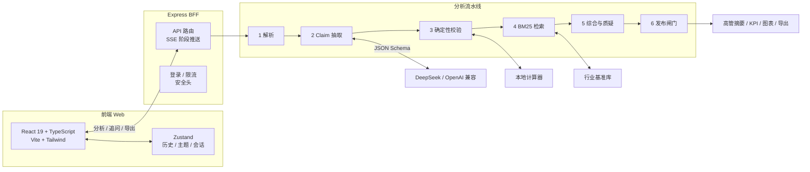

# 证析 EvidenceFlow

> 把经营材料变成一份能查证据的报告。

证析是一个可审计的 AI 经营分析工作台。上传会议纪要、经营复盘或 CSV 后，它先找数字和原文，再算公式、查行业基准，最后告诉你哪些结论能用、哪些缺证据。

**核心原则：AI 说出的每个数字，都能点回原文。**

- 在线演示：https://evidenceflow-yvnk.onrender.com
- 代码仓库：https://github.com/AWA0427/EvidenceFlow
- 作品介绍 PDF：[docs/作品介绍.pdf](docs/作品介绍.pdf)
- 技术文档 PDF：[docs/technical.pdf](docs/technical.pdf)
- 当前版本：v0.9.0 / 2026-11-14

## 功能

- **证据链**：每个数字都能回到原文段落，查看公式、状态和置信度。
- **确定性校验**：数字由本地计算器复算，不使用 `eval`；模型只负责抽取和解释。
- **行业基准**：BM25 检索 12 篇公开资料摘要，引用与生成分开。
- **质疑室**：检查缺基期、分母不清、把目标当结果；无依据的结论不进入高管摘要。
- **追问**：只基于当前看板回答，带 claim 引用，支持浏览器语音输入和朗读。
- **看板**：KPI、柱/线/饼/漏斗图、洞察、待办；图表可放大查看。
- **导出**：Markdown、打印/PDF。
- **主题**：Material 3 圆角、苔绿主色；浅色/深色、强调色、字号。
- **导航**：工作台 / 设置 / 关于；设置内分外观、API 与模型、数据与隐私。
- **工作区**：看板、证据链、质疑室、原始材料四个页签。

## 技术栈

- 前端：React 19、TypeScript、Vite 8、Tailwind CSS 4、Zustand、React Router
- 后端：Node.js、Express BFF、SSE
- AI：DeepSeek / OpenAI 兼容接口，JSON Schema 约束输出
- 分析：确定性计算器、BM25、质疑官、发布闸门

## 技术架构



### 8 步分析流程

```text
规划 → 解析 → 抽取 → 校验 → 检索 → 综合 → 质疑 → 发布闸门
```

- **抽取**：模型只抽「指标 + 数值 + 连续原文」，不改写。
- **校验**：引文定位、数值比对、受限四则运算复算。
- **检索**：BM25 召回行业基准，只解释，不替代企业数据。
- **质疑**：缺基期、分母不清、目标当结果，标为待核实。
- **闸门**：被拦截的主张不进高管摘要和导出报告。

## 目录结构

```text
evidenceflow/
├─ src/                React 页面、组件、store、主题
├─ server/             Express BFF、分析流水线、BM25、安全、登录
├─ shared/types.ts     前后端共享类型
├─ tests/              单元测试
├─ public/             静态资源
├─ index.html
├─ package.json
├─ pnpm-lock.yaml
├─ .env.example
├─ start.ps1
├─ 一键启动.bat
├─ open.ps1
└─ 打开网页.bat
```

> 本仓库只保留运行所需源码、配置和测试，不包含截图、PDF、示例素材或构建产物，避免仓库臃肿。

## 环境要求

- Node.js ≥ 20（推荐 22/24）
- pnpm ≥ 9（推荐 11；没有 pnpm 时可用 npm）
- Chrome / Edge（语音功能需要）

## 在线演示

[](https://render.com/deploy?repo=https://github.com/AWA0427/EvidenceFlow)

推荐部署到 Render（免费 Web Service，支持 Express + SSE，不用买服务器）：

1. 登录 [Render](https://render.com/)，New → Blueprint；
2. 连接 GitHub 仓库 `AWA0427/EvidenceFlow`；
3. Render 会自动读取根目录的 `render.yaml`；
4. 部署完成后访问 `https://<service-name>.onrender.com`；
5. 如果要启用实时 AI，在 Render 环境变量里添加 `DEEPSEEK_API_KEY`，不要提交到仓库。

说明：

- Render 免费实例闲置后会休眠，第一次打开可能需要几十秒唤醒；
- 在线演示默认 `DEMO_MODE=true`、`AUTH_REQUIRED=false`，三个内置示例无需登录；
- GitHub Pages 只能托管静态文件，不能运行 Express、SSE、登录和数据接口，所以本项目不能只靠 GitHub Pages 上线；
- 不需要买服务器，也不需要买域名；`onrender.com` 免费子域名足够作为比赛演示地址。

## 安装运行

```powershell
git clone https://github.com/AWA0427/EvidenceFlow.git
cd EvidenceFlow

corepack enable
pnpm install
Copy-Item .env.example .env.local
pnpm dev
```

打开 `http://127.0.0.1:3000`。

没有 pnpm 时：

```powershell
npm install
npm run dev
```

Windows 也可以直接双击根目录的 `一键启动.bat`，脚本会自动检查环境、安装依赖、生成 `.env.local` 并打开浏览器。

### 已经安装过，第二次启动

双击 **`打开网页.bat`**：

- 服务已在运行：直接打开本地网页，不重新安装
- 服务没运行：先启动服务，再打开网页
- 如果只想重新启动，也可以双击 `一键启动.bat`；检测到 `node_modules` 会跳过安装

## 常用命令

| 命令 | 作用 |
| --- | --- |
| `pnpm dev` | 开发模式（Express + Vite 中间件） |
| `pnpm build` | TypeScript 检查 + 生产构建 |
| `pnpm typecheck` | 只跑 TypeScript 检查 |
| `pnpm test` | 运行 Vitest |
| `pnpm start` | 启动生产服务 |

## 环境变量

复制 `.env.example` 为 `.env.local`，不要提交到 Git。

| 变量 | 必填 | 说明 |
| --- | --- | --- |
| `PORT` | 否 | 端口，默认 3000 |
| `DEMO_MODE` | 否 | 默认 true；无 Key 也能演示 |
| `ALLOW_CLIENT_KEY` | 否 | 是否允许设置页临时 Key；公网建议 false |
| `DEEPSEEK_API_KEY` | 否 | 服务端模型 Key；不填用示例/本地模式 |
| `DEEPSEEK_BASE_URL` | 否 | 默认 `https://api.deepseek.com` |
| `DEEPSEEK_MODEL` | 否 | 默认 `deepseek-chat` |
| `AUTH_REQUIRED` | 否 | true = 自定义材料必须先登录；示例不需要 |
| `REVIEW_USERNAME` | 否 | 评审账号，由团队私下设置 |
| `REVIEW_PASSWORD` | 否 | 评审密码，由团队私下设置 |
| `COOKIE_SECURE` | 否 | HTTPS 部署设 true |

安全约定：仓库只提交 `.env.example`；`.env.local` / `.env` 已忽略；临时 Key 只写 sessionStorage；日志不记录材料与 Key。

## 登录

- 登录页：`/login`，支持登录和注册
- 评审账号由团队私下提供，不在登录页面展示
- 登录框接受手机号；后端同时支持评审邮箱，普通注册仍要求 11 位手机号
- 注册用户保存在 `data/users.json`，密码用 scrypt + 随机盐哈希，不存明文
- 登录后签发 HttpOnly Session Cookie；会话存在服务端内存，重启服务后失效
- 不登录也能看三个示例
- `AUTH_REQUIRED=true` 时，上传自己的材料必须先登录
- 正式部署请改 `REVIEW_USERNAME` / `REVIEW_PASSWORD`，并持久化 `data/` 目录

## 测试

```powershell
pnpm typecheck
pnpm test
```

覆盖引用定位、数字解析、公式复算、BM25、PII 脱敏、Prompt Injection 检测和安全闸门。


## 说明

本项目为 2026 全国高校 AI Web 开发挑战赛参赛作品。示例企业、人物、数据均为虚构；AI 输出不构成审计、法律或投资建议。代码仓库不包含提交用 PDF、截图和演示视频，这些材料单独提交。
